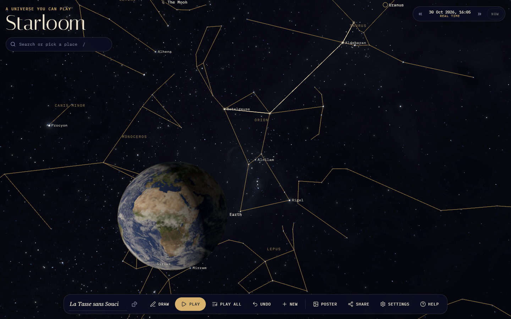
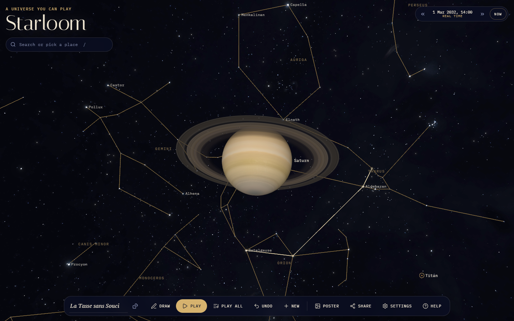
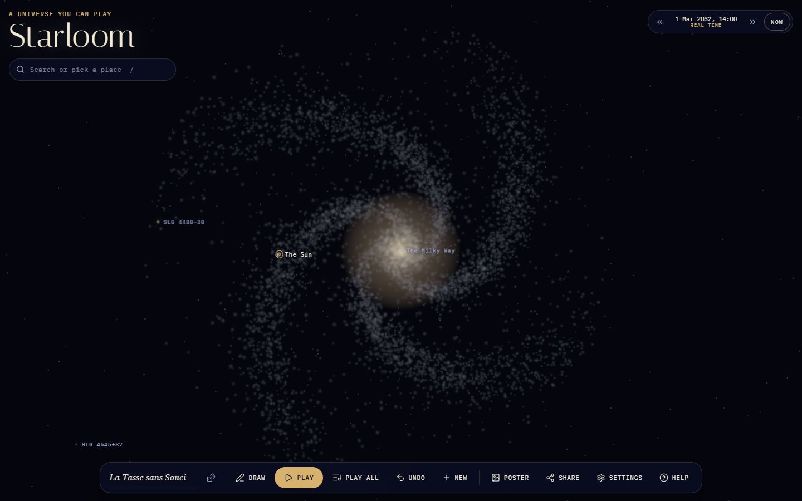
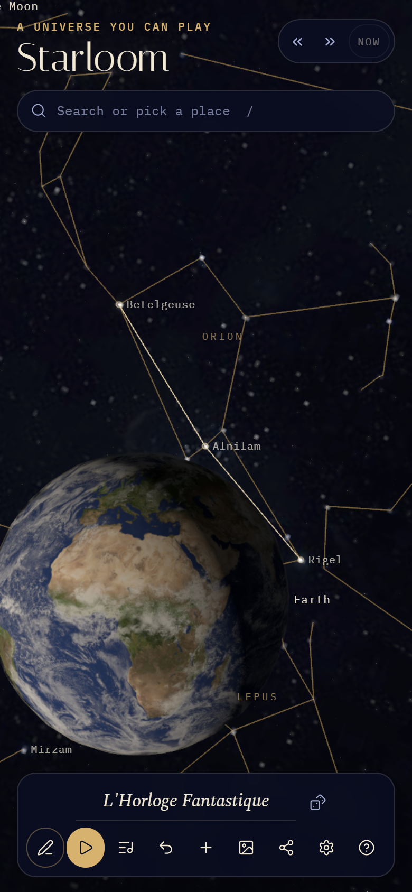

# Starloom

**The real sky, a universe beyond it, and every star a note.**

Fly through the Solar System as it is right now, out among the real stars and the 88 constellations, and on into an endless universe of imagined galaxies. Tap stars to join them into constellations of your own. Every star is a note, so a constellation is a melody, and because the shape is drawn between the stars' true positions in space, the melody bends as you travel.

**[Open Starloom →](https://marouncoder.github.io/starloom/)**



## What you can do

- **Fly anywhere, fluidly.** Drag to look, scroll or pinch to fly toward the pointer, WASD for the keyboard. Speed scales with the distance to the nearest thing, so you creep past the Moon and cross between galaxies in seconds. You can never fly into a planet.
- **See the real sky.** The planets and the major moons sit where they really are today, from [astronomy-engine](https://github.com/cosinekitty/astronomy). The 27,000 stars brighter than magnitude 7.5 come from the HYG catalogue, with their true distances and colours, and the 88 constellations are drawn between them.
- **Draw constellations.** Tap **Draw**, then tap stars, real or generated, to join them. Undo, rename with the French name generator, start again.
- **Play them.** Pitch comes from how high each star sits above the first one, as seen from wherever you are. The gap between notes comes from the angle between the stars, and loudness from their brightness. Fly to Alpha Centauri and your Orion sounds different. Real constellations play too, and **Make a copy** turns one into your own. **Play all** plays everything in view together.
- **Keep going forever.** Past the real data, Starloom imagines the rest. It generates star fields, nebulae, star clusters and galaxies, and flying into a galaxy resolves it, level by level, into stars you can draw with. The same place always looks the same, and anything made up is labelled *generated*.
- **Look things up.** Tap a planet, star, constellation or galaxy for its card. Search covers the planets, every named star and all 88 constellations, and a list of places to visit gets you started.
- **Bend time.** Run the clock forward or backward, up to a week a second, and jump back to now.
- **Share and print.** A link carries your constellations, where you are, what you are looking at and your sound, and nothing is uploaded. **Poster** saves the view as a 2400 × 3300 star chart.

<p align="center">
  
  
</p>
<p align="center">
  
</p>

## Controls

| Input | Action |
| --- | --- |
| Drag | Look around, or turn a planet you are circling |
| Scroll / pinch | Fly toward the pointer, or back |
| <kbd>W</kbd> <kbd>A</kbd> <kbd>S</kbd> <kbd>D</kbd> / arrows, <kbd>Q</kbd> <kbd>E</kbd> | Fly; down and up |
| <kbd>Shift</kbd> | Four times faster |
| Tap | What is that? |
| <kbd>C</kbd> | Draw: tap stars to join them |
| <kbd>Space</kbd> | Play or stop |
| <kbd>N</kbd> / <kbd>Ctrl</kbd> + <kbd>Z</kbd> | New constellation / undo |
| <kbd>F</kbd> / <kbd>L</kbd> | Constellation lines / labels |
| <kbd>H</kbd> | Back to Earth |
| <kbd>/</kbd> | Search |
| <kbd>Esc</kbd> | Close, stop drawing, let go of a planet |

## Running it locally

```bash
npm install
npm run dev      # http://localhost:5173/starloom/
npm test         # unit tests (Vitest)
npm run build    # production build in dist/
```

The star, constellation and texture files are committed. To rebuild them: `node scripts/build-lines.mjs`, then `node scripts/build-stars.mjs`, then `node scripts/fetch-textures.mjs`.

## How it works

Starloom is React 19 and TypeScript on Vite. three.js renders through React Three Fiber, and React draws the interface on top.

```
src/
  lib/space/    pure, tested: units and frames, ephemeris, the star catalogue, photometry,
                flight maths, the generated universe, star ids, music, search
  lib/          constellations, sharing, scales and instruments
  state/        camera, clock, flight, catalogue loading, universe streaming, the player, the store
  scene/        the three.js layer: planets, stars, galaxies, labels, input
  components/   the interface: toolbar, search, cards, panels
  render/       the poster
scripts/        build the star and constellation data, fetch the textures
```

A few details worth knowing:

- **Floating origin.** Every position is a float64 in kilometres in the equatorial J2000 frame. The camera never moves: each frame, every object is placed at its own position minus the camera's, so only small, camera-relative numbers reach the GPU. A logarithmic depth buffer covers a range from 1 km to across the universe.
- **A packed catalogue.** `scripts/build-stars.mjs` turns the 34 MB HYG CSV into a 670 KB binary of typed arrays: positions in parsecs, absolute magnitude, colour and constellation. It loads after the first frame. The shader computes each star's brightness from its real distance to the camera, every frame.
- **A nested, deterministic universe.** Each 1 Mpc cell of space holds a few galaxies seeded from its coordinates. Inside a galaxy, stars live in a grid of ten levels, from 25 pc to 12.8 kpc cubes, and each level holds only one brightness band. Big cubes hold rare bright stars and small cubes hold common faint ones, and each level is generated only near the camera, so there are always about 50,000 stars on screen. A generated star's id names its galaxy, level, cube and index (`gmw/3/12,-40,7/18`), so share links stay valid forever.
- **The real sky stays real.** Generated stars that would be brighter than magnitude 7.5 from Earth are never made. There are no made-up nebulae within 1,500 parsecs, and imagined galaxies only fade in once you are far from home.
- **Music from where you stand.** A star's note is its ecliptic latitude relative to the constellation's first star, seen from the camera, at 2° per scale step. Turning your head never changes a melody. Moving does.

Deployment is a GitHub Actions workflow that lints, tests, builds and publishes to GitHub Pages on every push to `main`.

## Credits and licences

- Code: [MIT](LICENSE).
- Stars: the [HYG database](https://github.com/astronexus/HYG-Database) v4.1 by David Nash, CC BY-SA 4.0. The repacked files in `public/data` are shared under the same licence.
- Constellation figures: [Stellarium](https://github.com/Stellarium/stellarium)'s modern sky culture, CC BY-SA 4.0.
- Planet, Moon, Sun and Milky Way images: [Solar System Scope](https://www.solarsystemscope.com/textures/), CC BY 4.0.
- Ephemeris: [astronomy-engine](https://github.com/cosinekitty/astronomy) by Don Cross, MIT.

Full details are in [`public/data/ATTRIBUTION.md`](public/data/ATTRIBUTION.md).
