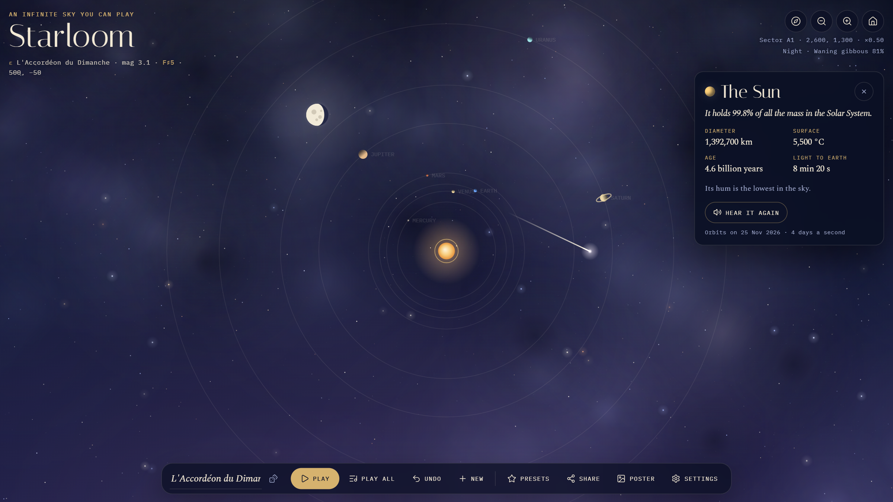

# Starloom

**An infinite night sky you can explore and play like an instrument.**

Tap the sky to place a star. Every star is a note. Stars placed one after another join into a constellation, and pressing Play turns it into a melody. Then drag and zoom to wander: past the Milky Way, through nebulae and star clusters, out to distant galaxies, and into a solar system where the planets sit where they really are today.

**[Open Starloom →](https://marouncoder.github.io/starloom/)**


## What you can do

- **Draw music.** Tap to place stars; tap an existing star to join it again. Higher stars sing higher, measured from the constellation's first star, so a melody sounds the same wherever you draw it. The rhythm follows the distance between stars.
- **Play the whole sky.** *Play all* loops every constellation in view at once, a small sky symphony.
- **Drop in famous constellations.** Orion, the Big Dipper, Cassiopeia, Cygnus, Lyra, the Southern Cross, Scorpius and Leo, projected from their real star positions.
- **Explore forever.** The universe is generated as you travel and is the same every time you come back. Three parallax layers give it depth.
- **Visit the planets.** The Solar System starts at today's real planetary positions, then orbits at four days a second. Tap a planet for facts and to hear its hum. Slower planets sing lower, the way Kepler imagined.
- **Catch shooting stars.** Each one leaves a wish behind.
- **Watch the night turn.** The sky drifts from dusk to night to dawn, and the moon shows today's real phase. Or pin it to *Always night*.
- **Choose a sound.** Chimes, glass bell, music box or soft pad, in major pentatonic, minor pentatonic, hirajōshi or lydian.
- **Share by link.** The whole sky (constellations, instrument and view) is compressed into the URL. Nothing is uploaded.
- **Print a poster.** Save the current view as a 2400 × 3300 star chart with a graticule, title and today's moon.

<p align="center">
  
  
</p>

## Controls

| Input | Action |
| --- | --- |
| Tap / click | Place a star, or join an existing one |
| Drag | Explore |
| Scroll / pinch | Zoom |
| <kbd>Space</kbd> | Play or stop this constellation |
| <kbd>N</kbd> | New constellation |
| <kbd>Ctrl</kbd> + <kbd>Z</kbd> | Undo |
| <kbd>P</kbd> | Famous constellations |
| <kbd>+</kbd> / <kbd>−</kbd>, arrow keys | Zoom and pan |
| <kbd>H</kbd> | Fly home |
| <kbd>?</kbd> | Help |

## Running it locally

```bash
npm install
npm run dev      # http://localhost:5173/starloom/
npm test         # unit tests (Vitest)
npm run build    # production build in dist/
```

## How it works

Starloom is React 19 + TypeScript on Vite, with one `<canvas>` for the sky and React for everything on top of it.

```
src/
  lib/           pure, tested logic
    sky/         procedural starfield, Milky Way band, deep-sky objects, planets, moon phase, day cycle
    music/       scales, Web Audio instruments, a shared audio engine with a small reverb
    share.ts     sky ⇄ URL encoding (lz-string)
  render/        the canvas renderer and the poster exporter (they share one renderScene function)
  state/         Zustand store, camera, input handling, the melody player
  components/    the HUD: toolbar, panels, cards
```

A few details worth knowing:

- **Deterministic infinity.** The sky is split into chunks. Each chunk's stars come from a seeded PRNG keyed on its grid coordinates, so nothing needs to be stored and every place is stable. Chunks are cached in a small LRU.
- **Level of detail.** Stars in a chunk are sorted brightest first; when you zoom out, only the brightest share is drawn, so the screen density stays constant.
- **Parallax.** Far layers see the camera at `cam × p` and zoom `zoom ^ p`, which makes galaxies drift slowly behind nebulae and nearby stars.
- **Real sky data.** Planet longitudes come from their J2000 mean longitudes and orbital periods. The moon phase is computed from a known new moon and the synodic month.
- **No re-renders while panning.** The camera lives in a plain mutable module, and the HUD reads a throttled snapshot of it through `useSyncExternalStore`.

Deployment is a GitHub Actions workflow that lints, tests, builds and publishes to GitHub Pages on every push to `main`.

## Licence

[MIT](LICENSE)
